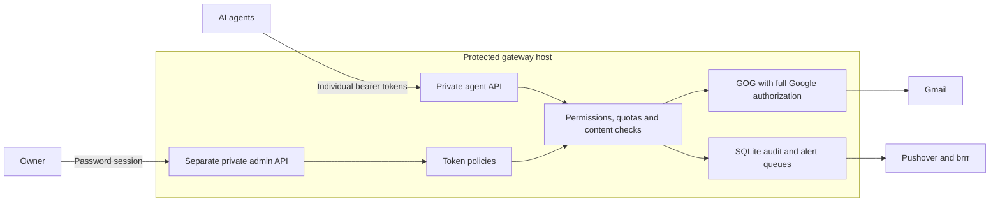

# Mailgate

**Give AI agents controlled access to Gmail while keeping Google credentials on a separate host.**

Mailgate is a small Go service that sits between your agents and your mailbox. Each agent gets a revocable token with its own permissions, quotas, and restrictions. The service holds the Google authorization, checks every request, records what happened, and alerts the owner when a request crosses a sensitive boundary.

Built with Go, SQLite, an embedded admin interface, and [GOG](https://github.com/openclaw/gogcli). Designed for a dedicated Linux host, including a Raspberry Pi running a 64-bit OS.

## Why this exists

A shopping agent may need to find receipts and send an order follow-up. A research agent may only need to search and read. A personal assistant may need a different set of messages altogether. Giving each of them the same Google credential makes those boundaries difficult to enforce and individual access difficult to revoke.

Instructions in an agent's prompt describe what it should do. Mailgate makes those access decisions in a service the agent does not control. A mistaken tool call, a malicious instruction inside an email, or a stolen agent token still encounters the token's permissions, mailbox restrictions, recipient rules, and quotas.

The underlying Google authorization can remain broad, including access to other Google products. Agents receive a deliberately small Gmail API. They cannot pass arbitrary requests through to Google or invoke GOG commands themselves. Adding a capability requires an explicit endpoint and policy decision in Mailgate.

The goal is useful delegation with a clear owner-controlled boundary: decide what each agent can do, inspect its activity, receive alerts, and revoke its access without distributing the underlying Google credential.

## The philosophy

| Principle | What Mailgate does |
| --- | --- |
| Give each agent a defined job | Separate `mail.search`, `mail.read`, and `mail.send` permissions, with optional mailbox and recipient restrictions |
| Keep credentials on a protected host | Run GOG under a dedicated OS account; agents authenticate only to Mailgate |
| Enforce policy outside the model | Validate requests, inspect returned messages, and apply permissions and quotas in the service |
| Make sending accountable | Add the owner's required CC/BCC in the service and retain a durable record of each send attempt |
| Make access revocable | Issue separate expiring tokens; change or revoke one agent's access independently |
| Keep an operational record | Record request metadata and policy events without storing raw passwords, bearer values, queries, or mail bodies in the audit log |
| Surface suspicious behavior | Queue independent Pushover and brrr alerts when configured rules trigger |
| Treat uncertain delivery carefully | Preserve pending or uncertain sends so a lost response cannot automatically trigger another send under the same key |

### A separate machine is part of the design

If an agent has root access to the machine holding the Google credential, it can go around the service. The intended deployment is a dedicated host whose SSH access, admin interface, credential files, and backups are outside the agents' control.

Agents reach the private API listener. The owner reaches a separate private admin listener. Network rules must enforce that separation; being on a tailnet alone does not establish who may administer the service. A shared development host is useful for testing, but it does not provide the dedicated host's isolation.

## How requests flow



Read requests inspect each candidate message before releasing its metadata or body. Send requests commit their intent and quota before contacting Gmail. Responses are held until the final audit record is durable; a storage failure prevents a successful disclosure response.

## What agents can do

| Endpoint | Permission | Behavior |
| --- | --- | --- |
| `GET /healthz` | None | Minimal service/database health check |
| `POST /v1/messages/search` | `mail.search` | Search inspected, permitted message metadata |
| `GET /v1/messages/{message_id}` | `mail.read` | Read one inspected, permitted message as plain text |
| `POST /v1/messages/send` | `mail.send` | Send plain text with recipient restrictions and the owner's configured copy |

That is the complete agent capability surface. Mailbox deletion, trashing, read-state changes, label mutation, drafts, settings, Google Drive, attachments, and arbitrary GOG commands have no exposed endpoint. Each Google account is configured by the operator; callers cannot select another account or credential source.

An agent with an existing token can search like this. Replace the example hostname with your private gateway address and supply `MAILGATE_TOKEN` from the agent's secret storage:

```sh
MAILGATE_BASE='https://mailgate.example:9444'

curl --fail-with-body \
  "$MAILGATE_BASE/v1/messages/search" \
  -H "Authorization: Bearer $MAILGATE_TOKEN" \
  -H 'Content-Type: application/json' \
  --data '{"query":"from:shop@example.com newer_than:30d","limit":10}'
```

See the [agent API reference](docs/api.md) for request/response shapes, pagination, quotas, and errors, or use the [OpenAPI schema](docs/openapi.yaml).

## Sensitive content and alerts

A search that matches a sensitive-content rule receives an ordinary successful empty result:

```json
{"messages":[]}
```

The owner receives a policy alert through Pushover and brrr, and the event appears in the audit log. Protected direct reads receive the same 404 as a missing message. The response does not identify the rule that triggered.

Checks cover normalized search terms, configurable sensitive keywords, identity/payment/authentication patterns, and returned message content. Direct message-ID reads undergo the same inspection and mailbox restrictions as search results. Outgoing content is inspected as well.

These checks are conservative and imperfect. Novel wording, obfuscation, and false positives remain possible. Timing and quotas can reveal that filtering exists. Version 1 withholds entire messages containing uninspectable attachments, including many inline signature images; it does not perform OCR or PDF extraction. Allowed Gmail label IDs and globally blocked labels provide additional limits on the messages an agent can access.

Alert deliveries are stored in separate durable queues with retry/backoff. A provider outage can delay a notification, and a crash after delivery can produce a duplicate alert. The admin interface shows pending deliveries.

## Sending without silent or accidental duplicates

Each token can require the owner to receive a CC or BCC on every send. Mailgate adds that copy after validating the caller's recipients. The agent cannot suppress it; only the owner can choose a policy with no required copy.

Sending also requires an `Idempotency-Key`. Mailgate records the operation before contacting Gmail and returns a completed result when the same permitted request is repeated with the same token and key. An unresolved send remains pending or uncertain for owner review. Clients must preserve the original key and payload when delivery is uncertain.

GOG's stock transport can retry failed send requests. Mailgate therefore requires a pinned GOG build with a small patch disabling those automatic retries. Regression tests exercise both GOG send paths against simulated 429, 500, and 503 responses and verify that each produces exactly one send POST.

## Owner administration

The web interface provides token creation, listing, editing, revocation, deletion, activity review, alert status, uncertain-send review, and password changes. Token secrets are shown once and stored only as hashes. Agent tokens never authenticate to the admin interface.

On an unconfigured instance, the first admin visit automatically opens password setup. Choose or generate a password in the browser. **Restrict the admin route to the owner's trusted device before opening an unconfigured instance:** the first eligible visitor can initialize it. Setup closes atomically after the password is saved.

Subsequent visits use password login. Password changes invalidate all admin sessions. The [integration guide](docs/integration-guide.md) documents the owner administration API as well as agent usage.

## Deploying

The runtime consists of the Mailgate binary, its embedded web assets, SQLite state, and the required GOG executable. Node is used only for browser tests. A separate database server, Redis, and a frontend build service are unnecessary.

1. Prepare a dedicated Linux host and private network rules. Give agents access to the API port and reserve the admin and SSH routes for the owner.
2. Build Mailgate and the pinned GOG variant for the target architecture.
3. Install the service and provision Google authorization and notification credentials into the private service directories.
4. Configure private HTTPS, start the service, and open the admin interface to choose the owner password.
5. Create a token for each agent and verify its allowed operations and denied boundaries.

The [deployment guide](docs/deployment.md) includes the installer, systemd units, credential layout, network policy example, backups, and migration instructions. Tailscale Serve is supported for private HTTPS. Public Funnel exposure is outside the intended deployment model.

## Build and test

Go **1.27.2** or later is required. With `GOTOOLCHAIN=auto`, the Go tool can download the required toolchain.

```sh
make check       # Unit/integration tests, race detector, go vet
make build       # bin/mailgate
make release     # Linux ARM64 + AMD64 binaries and checksums
make vuln        # Gateway dependency vulnerability scan

npm ci
npm test         # Browser tests using fake Gmail and disposable state
```

The browser test expects `/usr/bin/chromium`; set `CHROMIUM_PATH` for another installation. It exercises first-visit setup, password generation and changes, login, token CRUD, XSS escaping, and mobile layout. Automated tests use fake Gmail and notification transports.

Build the required GOG variant with an absolute output path:

```sh
scripts/build-gog.sh /absolute/path/to/gog-linux-arm64 arm64
# Use amd64 for an x86-64 host.
```

The script fetches GOG v0.38.2, updates the audited dependencies, applies the single-attempt send patch, and runs its regression checks. The installer and Mailgate both check the required build marker. Replacing it with an unpatched upstream binary fails the startup check.

## Status and security boundaries

Mailgate is an early implementation with automated backend/browser tests and Linux ARM64/AMD64 builds. An independent security review is still outstanding. The [verification record](docs/verification.md) describes completed checks and the remaining dependency-scanner finding; it also distinguishes mock send testing from live Google checks.

Its protection depends on the gateway host, operating system, administrator, and network policy. A compromised service process or root access to that host can reach the full Google authorization. Audit records are private and durable, but they are not immutable against root. Revocation stops subsequent authentication; requests already in flight may finish.

Read the [security model](docs/security.md) before deploying. A prepared read-only Claude review can be run with `scripts/review-claude.sh` after authenticating the CLI.

## Documentation

| Document | Purpose |
| --- | --- |
| [Deployment](docs/deployment.md) | Installation, private networking, credentials, backup, and migration |
| [Agent API](docs/api.md) | Search, read, send, quotas, and errors |
| [Integration guide](docs/integration-guide.md) | Examples and owner administration API reference |
| [OpenAPI](docs/openapi.yaml) | Machine-readable agent API schema |
| [Security model](docs/security.md) | Implemented controls, trust boundaries, and limitations |
| [Verification](docs/verification.md) | Test evidence and outstanding review items |

## License

Mailgate is available under the [MIT License](LICENSE). See [third-party notices](THIRD_PARTY_NOTICES.md) for the GOG patch attribution and dependency licensing.
